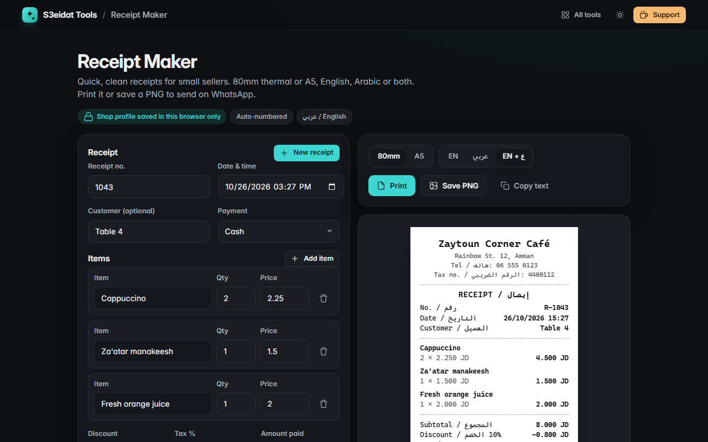

# Receipt Maker

> Quick, simple receipts for small sellers: 80mm thermal or A5, English, Arabic or both. Free, private, and it runs entirely in your browser.

### ▶ [Open Receipt Maker](https://s3eidat.github.io/receipt-maker/)



## Features

- **80mm thermal** (prints at the receipt's real length) or **A5** layout
- Labels in **English**, **Arabic (RTL)**, or **both** (`Total / الإجمالي`)
- Items with quantity and price, **discount** (% or fixed amount), **tax %**, payment method (cash, card, transfer, e-wallet)
- **Amount paid → change** for cash sales
- **Auto-numbered**: "New receipt" moves to the next number and keeps your shop details
- Shop profile (name, address, phone, tax number, currency label, decimals, footer) **saved in this browser**
- **Print**, **save as PNG** (576 px wide for thermal, ready to send on WhatsApp), or **copy as text**

## Privacy

Nothing leaves your device. The shop profile and the current receipt are stored in your browser's localStorage,
with no server, no account and no analytics. The page ships with a strict Content-Security-Policy
(`connect-src 'self'`), so the browser itself blocks any attempt to send data anywhere.

## Run it yourself

It's plain HTML, CSS and JavaScript with no build step:

```bash
git clone https://github.com/s3eidat/receipt-maker
cd receipt-maker
python -m http.server 8000
```

Then open http://localhost:8000.

## Support

If this saved you time, **[buy me a coffee ☕](https://s3eidat.github.io/coffee/)**. It keeps every tool free.

---

Part of **[S3eidat Tools](https://s3eidat.github.io/)**: 100+ free, private tools that run in your browser. MIT licensed.
